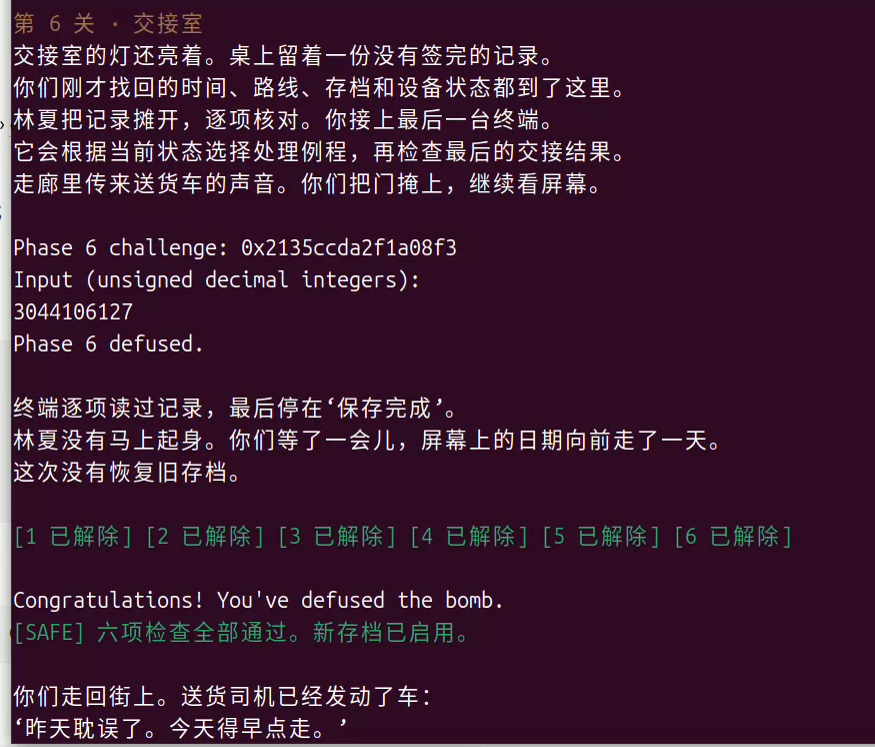
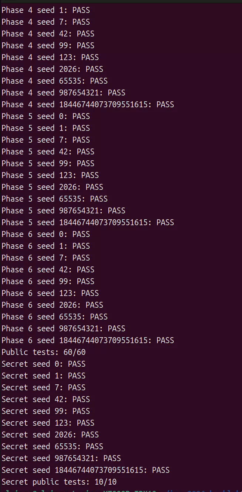

**Lab2 BombLab 实验报告**  
   
 姓名：李天呈 学号：25803050053  
   
 **实验内容**  
   
 分析炸弹 `bomb` 的汇编，在 `defuser.c` 中实现六个正式关卡及 Honor 的通用解法。每关根据 `challenge` 计算口令，生成字符串交给炸弹验证。  
   
 **关卡分析**  
   
 **Phase 1：函数调用与参数传递**  
   
 `valid_u32_fields` 的数量参数和 `sscanf` 的返回值检查均为 1，说明本关输入一个整数。`phase_01` 调用 `p1_compute` 后，将 `eax` 与栈上的输入比较，因此需要恢复这个函数的返回值。  
   
 `p1_compute` 将 challenge 右移 32、16 位，并在调用前使用 `edi、esi` 传入低 32 位参数。追踪三次调用可得：先调用 `p1_step1(high, middle)`，再调用 `p1_step0(low, high)`，最后调用 `p1_step2(t0, t1)`。三个 helper 的关键指令为：  
```  
# p1_step0(x, y)    
  lea    (%rdi,%rsi,4),%eax    
  xor    $0x8dd,%eax    
  # p1_step1(x, y)    
  sub    %esi,%edi    
  lea    0x898a(%rdi,%rdi,2),%eax    
  # p1_step2(x, y)    
  xor    $0x9975,%esi    
  lea    (%rsi,%rdi,8),%eax    
      
   
```  
`lea` 只计算表达式，不读取内存，所以三段分别对应加四倍、减法后三倍加常量、乘八后异或结果。恢复出的计算为：  
```  
low = u32(challenge);    
  middle = u32(challenge >> 16);    
  high = u32(challenge >> 32);    
  t1 = 3 * (high - middle) + 0x898a;    
  t0 = (low + 4 * high) ^ 0x8dd;    
  answer = 8 * t0 + (t1 ^ 0x9975);    
      
   
```  
其中 `middle` 保留原数第 16～47 位，不能只取 16 位。最终输出 `answer` 一个整数。  
   
 **Phase 2：数组与递推关系**  
   
 本关检查六个整数，输入数组从 `rbp-0x40` 开始，每项相隔 4 字节。首项检查中的 `shr $0xe`、`movzbl %al,%eax` 和 `xor $0x5`，说明先将 challenge 右移 14 位，取低 8 位，再异或 5。  
   
 循环的关键指令为：  
```  
mov    $0x11,%ecx                 # 移位数从 17 开始    
  mov    $0x1,%edx                  # 下标从 1 开始    
  # 循环体    
  mov    %r13,%rax                  # challenge    
  lea    (%rsi,%rsi,2),%esi         # 前一项乘以 3    
  shr    %cl,%rax    
  and    $0x1f,%eax    
  add    %edx,%eax    
  xor    %esi,%eax    
  mov    -0x40(%rbp,%rdx,4),%esi     # 读取 a[i]    
  cmp    %eax,%esi    
  # 比较通过后    
  add    $0x1,%rdx    
  add    $0x2,%ecx    
  cmp    $0x6,%rdx    
  jne    402178    
      
   
```  
`rdx` 是下标，每轮加 1；`ecx` 是移位数，每轮加 2，所以移位数为 `15+2*i`。`esi` 开始保存前一项，完成本轮比较后被更新为当前输入，供下一轮继续使用。得到递推关系：  
```  
a[0] = ((challenge >> 14) & 0xff) ^ 5;    
  for (i = 1; i < 6; ++i) {    
      part = (challenge >> (15 + 2*i)) & 0x1f;    
      a[i] = (3 * a[i-1]) ^ (part + i);    
  }    
      
   
```  
按顺序输出六项即可。  
   
 **Phase 3：switch 与跳转表**  
   
 本关读取两个数。第一个数与 `challenge & 7` 比较；随后将 challenge 右移 3 位与右移 32 位的低 32 位异或，作为分支函数的参数：  
```  
index = challenge & 7;    
  x = u32(challenge >> 3) ^ u32(challenge >> 32);    
      
   
```  
`p3_dispatch` 中的关键跳转为：  
```  
mov    %edi,%eax    
  mov    %esi,%edi    
  cmp    $0x7,%eax    
  ja     402295    
  notrack jmp *0x405820(,%rax,8)    
      
   
```  
表项是 8 字节地址。读取 `0x405820` 的八个表项，再跟踪目标跳板，可以发现其顺序不是 helper 名称中的编号顺序。结合 helper 中的命令信息，得到：  
  
|  |  |  |  
| - | - | - |  
|   |    |    |  
| **`index`** |  **实际分支** |  **第二个数** |  
| 0 |  `p3_case_2` |  `3*x + 0xfdb6` |  
| 1 |  `p3_case_3` |  `(2*x) ^ 0xaf5b` |  
| 2 |  `p3_case_5` |  `(4*x) ^ 0x3d2d` |  
| 3 |  `p3_case_4` |  `5*x + 0x1cead` |  
| 4 |  `p3_case_1` |  `(x ^ 0x94b9) + (x >> 1)` |  
| 5 |  `p3_case_0` |  `5*x + 0xf9fb` |  
| 6 |  `p3_case_7` |  `(x ^ 0xd0c2) + (x >> 1)` |  
| 7 |  `p3_case_6` |  `5*x + 0xbaa9` |  
  
   
   
   
 例如 `p3_case_2` 的 `lea 0xfdb6(%rdi,%rdi,2),%eax` 就是 `3*x+0xfdb6`。在求解器中按实际表项写 `switch`，输出 `index` 和对应分支的结果。  
   
 **Phase 4：递归调用与返回过程**  
   
 本关输入一个数。调用 `p4_walk` 前，四个参数分别整理为：  
```  
target = challenge & 0x7f;    
  lower = 0;    
  upper = 127;    
  salt = u32(challenge >> 7) ^ u32(challenge >> 32);    
      
   
```  
函数通过 `sub %esi,%edi`、`shr $1,%edi`、`add %esi,%edi` 算出 `middle=lower+((upper-lower)>>1)`。随后比较 target 与 middle：相等进入基例，小于进入 `[lower,middle-1]`，大于进入 `[middle+1,upper]`。`cmp %edi,%eax` 后使用 `jb` 无符号比较。  
   
 关键的返回值计算为：  
```  
# 命中时：middle 在 edi，salt 在 ecx    
  lea    0x83(%rdi),%eax    
  xor    %ecx,%eax    
  # 递归返回后：ebx 保存 middle + salt    
  lea    (%rax,%rax,2),%eax    
  xor    %ebx,%eax    
  # 左分支再 xor $0xa,%eax；右分支再 xor $0x15,%eax    
      
   
```  
因此不能只恢复二分查找的路径，还要恢复递归返回时逐层组合的运算：  
```  
middle = lower + ((upper - lower) >> 1);    
  if (target == middle)    
      return (middle + 0x83) ^ salt;    
  if (target < middle)    
      return (3 * walk(target, lower, middle-1, salt))    
             ^ (middle + salt) ^ 0x0a;    
  return (3 * walk(target, middle+1, upper, salt))    
         ^ (middle + salt) ^ 0x15;    
      
   
```  
最终口令为 `walk(target,0,127,salt)`。验证 seed 下，target 为 104，依次经过中点 `63、95、111、103、107、105、104`，命中后逐层返回，得到 `2956306760`。  
   
 **Phase 5：结构体与链表遍历**  
   
 本关读取两个数，分别检查 `p5_traverse` 的返回值和它通过指针写出的最后节点编号。关键内存访问为：  
```  
mov    0x405b60(,%rax,8),%rdx     # 从头指针表取起点    
  mov    0x4(%rdx),%esi            # id    
  xor    (%rdx),%eax               # value    
  add    %esi,%eax    
  mov    %esi,(%r8)                # 保存最后访问的 id    
  mov    0x8(%rdx),%rdx            # 移动到 next    
      
   
```  
偏移 0、4 处按 32 位读取，偏移 8 处按 64 位读取并作为地址使用，因此节点布局为两个 `uint32_t` 字段 `value、id`，以及一个 `next` 指针，总大小为 16 字节。  
   
 从 `0x405ba0` 开始按地址顺序读取 12 个节点，编号为 0～11；再读取 `0x405b60` 的八个入口，得到对应节点下标 `1、11、5、4、8、7、9、10`。将节点数据和指针关系恢复为静态链表。  
   
 起点下标为 `challenge & 7`，移动次数为 `(challenge >> 3) & 3`。累积初值和每个节点的更新规则为：  
```  
state = u32(challenge >> 6) ^ u32(challenge >> 32) ^ 0x242b;    
  // 每访问一个节点    
  state = (state ^ current->value) + current->id;    
  last_id = current->id;    
      
   
```  
首节点在进入后续循环前就参与计算，所以共访问“移动次数 + 1”个节点。输出 `state` 和 `last_id`。  
   
 验证 seed 下，入口下标为 1，移动 3 次，初始 state 为 `1282941908`。访问过程如下，也验证了起点计入计算的规则：  
  
|  |  |  |  |  
| - | - | - | - |  
|   |    |    |    |  
| **节点下标** |  **`value`** |  **`id`** |  **更新后的 state** |  
| 11 |  `0x34ee` |  78 |  1282938760 |  
| 5 |  `0x7351` |  1104 |  1282959657 |  
| 4 |  `0x94b2` |  801 |  1282998460 |  
| 8 |  `0x7b05` |  2571 |  1283032516 |  
  
   
   
   
 **Phase 6：函数指针与间接调用**  
   
 本关输入一个数。`p6_dispatch` 通过同一函数指针表连续调用两次，中间插入异或，最后再加常量：  
```  
and    $0x38,%ebx    
  and    $0x7,%eax    
  call   *0x405e00(,%rax,8)    
  xor    $0xdba3,%eax    
  mov    %eax,%edi    
  call   *0x405e00(%rbx)    
  add    $0x7533,%eax    
      
   
```  
第一次下标是 `challenge & 7`。第二次的 `rbx` 已经是 `challenge & 0x38` 这个字节偏移，除以每项的 8 字节，才得到下标 `(challenge >> 3) & 7`。  
   
 读取 `0x405e00` 的八个地址，顺序为 `op3、op4、op2、op5、op3、op0、op1、op5`。各运算由目标函数中的指令恢复为：  
  
|  |  |  
| - | - |  
|   |    |  
| **函数** |  **运算** |  
| `op0` |  `(x ^ (x >> 7)) + 0x3cfa` |  
| `op1` |  `(x ^ 0x41b9) + 2*x` |  
| `op2` |  `rol32(x,7) ^ 0x2e76` |  
| `op3` |  `ror32(x,3)` |  
| `op4` |  `(x + 0x1260) ^ (x >> 5)` |  
| `op5` |  `(2*x + 0x1809) ^ (7*x)` |  
  
   
   
   
 `rol`、`ror` 是 32 位循环移位，需要将移出的位绕回。分别实现为 `(x<<7)|(x>>25)` 和 `(x>>3)|(x<<29)`。  
   
 设 `F` 为实际顺序的函数表，完整计算关系为：  
```  
first = challenge & 7;    
  second = (challenge >> 3) & 7;    
  x = u32(challenge >> 6) ^ u32(challenge >> 32);    
  intermediate = F[first](x) ^ 0xdba3;    
  answer = F[second](intermediate) + 0x7533;    
      
   
```  
验证 seed 下，两次下标为 3、6，对应 `op5` 和 `op1`。初始 x 为 `1233757433`，第一次返回 `2446385972`，异或后为 `2446342295`，第二次返回 `3044076124`，加常量后得到 `3044106127`。  
   
 **Honor：输入布局与相邻字段覆盖**  
   
 完整运行六关后，通过管道或文件提供第七行才能进入 Honor。驱动先根据前六行口令生成 context，再传给 `solve_secret`。  
   
 `secret_gate` 的关键检查为：  
```  
lea    -0xd0(%rbp),%r12          # 复制起点    
  # strlen 返回后    
  sub    $0x24,%rax    
  cmp    $0x7f,%rax    
  jbe    402770    
  # secret_copy 复制后    
  cmpl   $0x4e45504f,-0xb0(%rbp)    
  jne    40275b    
  lea    -0xac(%rbp),%rdi          # 三整数文本起点    
  call   402630 <secret_phase>    
      
   
```  
无符号长度判断对应 `length-36<=127`，允许长度为 36～163 字节。`secret_copy` 逐字节复制直到 `\0`，不会在前 32 字节处停止。复制起点与标志字段相差 `0xd0-0xb0=32` 字节；标志值 `0x4e45504f` 按小端序排列为 `4f 50 45 4e`，即 `OPEN`。传给 `secret_phase` 的位置则在偏移 36。  
   
 因此第七行可构造为 **32 个 A + OPEN + 三个空格分隔的无符号整数**。这里通过相邻字段覆盖满足标志条件，不需要覆盖返回地址。  
   
 `secret_phase` 中的 `and $0x3,%ecx` 确定第一个数；高低 32 位异或得到 challenge 和 context 的折叠值。第二个数使用 `secret_mix`，其关键指令为：  
```  
mov    %edi,%eax    
  xor    $0x2770,%edi    
  shr    $0x3,%eax    
  xor    $0x76f4,%eax    
  add    %edi,%eax    
      
   
```  
`secret_phase` 随后将返回值异或 `a*0x2770` 和 `u32(context>>16)`，得到第二个数。第三个数再异或由折叠值、首项和 `0x76f4` 组成的和。完整关系为：  
```  
C = u32(challenge) ^ u32(challenge >> 32);    
  T = u32(context) ^ u32(context >> 32);    
  a = context & 3;    
  x = C ^ T;    
  mixed = (x ^ 0x2770) + ((x >> 3) ^ 0x76f4);    
  b = mixed ^ (a * 0x2770) ^ u32(context >> 16);    
  c = b ^ ((C >> 3) + T + a + 0x76f4);    
      
   
```  
使用 `snprintf` 拼接前缀与 `a、b、c`。验证 seed 下，Honor challenge 为 `0xbd01e820ab3acc1a`，context 为 `0xdddd2cdf87c698bb`；三整数为 `3、2038099387、630809177`，整行长 58 字节，满足长度要求。  
   
 **本地测试结果**  
   
 本地测试统一 **`seed=20070522`**，重新编译后逐关检查各关的实际验证记录如下。前六关分别输出 `Phase N defused.`；完整运行的末尾输出 `Congratulations! You've defused the bomb.` 和 `Secret phase defused.`。  
  
|  |  |  |  |  
| - | - | - | - |  
|   |    |    |    |  
| **关卡** |  **challenge** |  **口令** |  **结果** |  
| Phase 1 |  `0x92f2b9b4d1d61cf3` |  `2026058049` |  PASS |  
| Phase 2 |  `0x67b61149a334750b` |  `212 615 1853 5547 16651 49975` |  PASS |  
| Phase 3 |  `0x7b6310d5fb94c8e0` |  `0 1278581521` |  PASS |  
| Phase 4 |  `0x302842c7fc6691e8` |  `2956306760` |  PASS |  
| Phase 5 |  `0x3984ac1d7f2af899` |  `1283032516 2571` |  PASS |  
| Phase 6 |  `0x2135ccda2f1a08f3` |  `3044106127` |  PASS |  
| Honor |  `0xbd01e820ab3acc1a` |  见下方 |  PASS |  
  
   
   
```  
AAAAAAAAAAAAAAAAAAAAAAAAAAAAAAAAOPEN3 2038099387 630809177    
      
   
```  
公开测试结果为：  
```  
Public tests: 60/60    
  Secret public tests: 10/10    
      
   
```  
  
  
**参考资料与辅助工具**  
   
 参考[课程实验说明、](https://ics-26fall-fdu.github.io/labs/lab2-bomb-lab/ "https://ics-26fall-fdu.github.io/labs/lab2-bomb-lab/")[官方模板及实验包中的 `README.md`、`tutor/README.md`、`challenge.c`、`phase_support.c` 和测试驱动。  
   
 使用 ChatGPT/Codex 进行引导，辅助解释汇编与 gdb 教导与整理报告。](https://github.com/ICS-26Fall-FDU/BombLab "https://github.com/ICS-26Fall-FDU/BombLab")  
